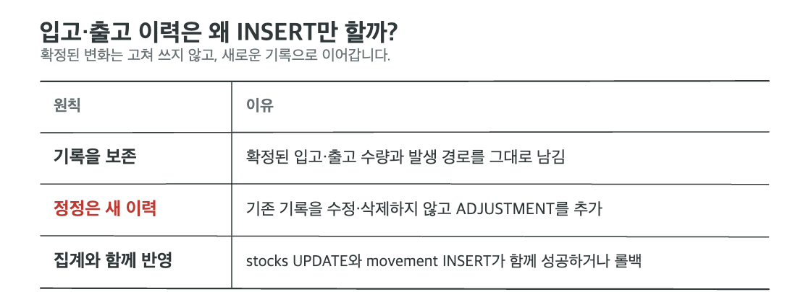

# Stock Management System

SKU 기준으로 입고·출고를 처리하고 현재 재고와 변경 근거를 관리하는 REST API입니다.

## 시작

### 0. 실행 방법 및 기술 스택

| 항목 | 설정 |
| --- | --- |
| 실행 환경 | Java 21, Docker Compose |
| 애플리케이션 | Spring Boot 4.1.3, Gradle Kotlin DSL |
| 데이터베이스 | PostgreSQL 17, Spring Data JPA, Flyway |
| API 문서 | springdoc-openapi 3.2.0 |
| 테스트 | JUnit Jupiter 5.14.4, Testcontainers 2.0.5 |
| 커넥션 풀 | Spring Boot 기본 HikariCP, 최대 연결 10 |
| 프로젝트 버전 | `0.1.0-SNAPSHOT` |

준비되면 실행합니다.

```bash
./run-local.sh
```

PostgreSQL 기동, Flyway DDL 적용, 애플리케이션 실행을 한 번에 합니다. HTTP 포트는 시작 로그에서 확인하고 Swagger UI는 `http://localhost:<port>/swagger-ui.html`에서 엽니다. `SERVER_PORT`, `DB_URL`, `DB_USERNAME`, `DB_PASSWORD`, `TENANT_ID`로 로컬 설정을 바꿀 수 있습니다.

## 설계

### 1. 설계 요약

응답은 과제 형식인 `id`, `name`, `quantity`를 유지합니다. API 기본 경로는 `/api/v1`입니다.

| Method | 경로 | 요청 | 성공 | 주요 오류 |
| --- | --- | --- | --- | --- |
| `POST` | `/stocks/inbound` | `sku`, 양수 `quantity`, UUID `requestId`; 선택 `name`, `reason` | 상품 ID·이름·현재 수량 | `400` 요청 오류, `409` 중복 요청 ID |
| `POST` | `/stocks/outbound` | `sku`, 양수 `quantity`, UUID `requestId`; 선택 `reason` | 상품 ID·이름·현재 수량 | `400` 요청 오류, `404` 미등록 SKU, `409` 재고 부족·중복 요청 ID |
| `GET` | `/stocks/{itemId}` | 상품 ID | 상품 ID·이름·현재 수량 | `404` 미등록 상품 |

입고 요청 예시입니다. 출고는 `name` 없이 같은 형식으로 요청합니다.

```json
{
  "sku": "SKU-001",
  "name": "상품 A",
  "quantity": 10,
  "requestId": "11111111-1111-1111-1111-111111111111"
}
```

입고·출고 응답은 `id`, `name`, `quantity`를 반환합니다.

```json
{"id": 1, "name": "상품 A", "quantity": 10}
```

잘못된 요청은 `400`, 미등록 상품 조회·출고는 `404`, 재고 부족과 중복 요청 ID는 `409`입니다. 오류 응답에는 `code`, `message`가 포함됩니다.

SKU는 고객사별 상품 식별자이며, 응답 `id`는 내부 상품 ID입니다. SKU 앞뒤 공백은 제거하고 대소문자는 구분합니다. 미등록 SKU의 입고는 상품을 자동 등록하며 `review_status`를 `NEEDS_REVIEW`로 둡니다. 이름은 없어도 되며 응답의 `name`은 `null`일 수 있습니다. 상품 보정 API는 MVP 범위 밖입니다.

| 테이블 | 책임 |
| --- | --- |
| `items` | 고객사별 SKU와 상품 정보 |
| `stocks` | 상품별 현재 수량. 조회와 원자적 출고 검증에 사용 |
| `stock_movements` | 확정된 입고·출고·조정 증감 기록 |


movement의 필드는 서로 다른 질문에 답합니다.

| 필드 | 의미 | 값 예시 |
| --- | --- | --- |
| `event_type` | 어떤 변화인가 | `INBOUND`, `OUTBOUND`, `ADJUSTMENT` |
| `source_type` | 어디서 발생했나 | `API`, `EXTERNAL`, `SYSTEM` |
| `reason` | 왜 조정했나 | 실사 차이, 외부 시스템 정정 |

현재 API는 입고·출고를 `source_type=API`로 기록합니다. `ADJUSTMENT`, `EXTERNAL`, `SYSTEM`은 DDL에 정의된 값이며, 해당 처리 API는 구현하지 않았습니다. DB는 `ADJUSTMENT` 또는 `SYSTEM` 기록에 사유를 요구합니다.

### 2. 핵심 설계 이유

#### 시나리오 기준

| 상황 | 처리 흐름 | 보장 |
| --- | --- | --- |
| 미등록 SKU 첫 입고 | 상품 등록 시도 → SKU로 `itemId` 조회 → `stocks` 생성·증가 → movement INSERT | 상품·재고·이력을 한 번에 반영 |
| 동일 SKU 동시 최초 입고 | `(tenant_id, sku)` 유일 제약으로 등록 경쟁 처리 → 각 요청이 재고 증가·이력 기록 | 상품 행은 하나, 요청 수량은 누락되지 않음 |
| 재고 부족이 섞인 동시 출고 | `quantity >= 요청 수량` 조건부 UPDATE | 가능한 출고만 반영하고 실제 부족 요청은 `409`; 음수 재고 방지 |

상품 등록 후의 SKU 조회는 트랜잭션이 끝난 뒤 하는 조회가 아닙니다. `ON CONFLICT DO NOTHING`이 상품 ID를 돌려주지 않으므로, 같은 Service 트랜잭션 안에서 이후 `stocks`에 연결할 `itemId`를 얻습니다. 응답용 현재 수량도 트랜잭션 안에서 읽고 Service가 반환된 뒤 커밋합니다.

#### 기술 설계 기준

| 선택 | 기술적 이유 | 트레이드오프·경계 |
| --- | --- | --- |
| `stocks` 집계와 movement 이력 분리 | 현재 수량을 원장 `SUM` 없이 읽고, 변경 근거는 보존 | 모든 재고 변경은 같은 트랜잭션을 거쳐야 함 |
| 조건부 원자 UPDATE | 수량 비교와 증감을 DB 한 문장으로 처리. 같은 행 UPDATE는 PostgreSQL이 순서대로 조정 | 같은 상품 요청은 행 갱신 중 대기할 수 있음 |
| PostgreSQL 기본 `READ COMMITTED` | 각 SQL 문장이 시작될 때 커밋된 데이터를 읽음. 격리 수준은 별도 변경하지 않음 | 일반 SELECT는 행 잠금이 아니며, 연속 SELECT가 같은 스냅샷을 보장하지 않음 |
| 재고 변경과 movement INSERT를 한 트랜잭션으로 처리 | 어느 한쪽이 실패하면 둘 다 롤백 | 처리 흐름 중 DB 연결을 사용하므로 트랜잭션 안에 외부 호출을 넣지 않음 |
| 재고 조회 DTO projection | `Item`과 `Stock`을 한 JPQL 쿼리로 반환해 추가 조회와 N+1 방지 | 관계 매핑 대신 필요한 필드를 쿼리에 명시 |
| 요청마다 ledger `SUM`을 재검사하지 않음 | 별도 SUM 쿼리는 원자 UPDATE의 동시성 방어가 아니며 매 요청 비용 추가 | 현재고와 movement 합계 일치는 통합 테스트에서 확인 |

#### 원자 UPDATE를 선택한 이유

입고·출고 요청의 일반적인 경합을 낙관적 잠금 오류로 호출자에게 돌려보내 재시도시키기보다, DB가 같은 재고 행을 순서대로 처리하게 했습니다. 자동으로 진행되는 재고 처리에서 기술적 충돌 응답을 줄이고, 출고는 실제 재고가 부족할 때만 `409`를 반환합니다.

| 대안 | 이번 MVP에서 선택하지 않은 이유 | 재검토 조건 |
| --- | --- | --- |
| `@Version` 낙관적 잠금 | 충돌을 사용자에게 알리고 재시도시켜야 함 | 업무상 다른 요청의 변경을 반드시 인지해야 할 때 |
| `SELECT FOR UPDATE` 명시적 비관적 잠금 | 잠글 키·획득 시점·보유 범위를 정해야 하고 트랜잭션이 길면 대기·경합 가능 | 실제 대기 시간이 커져 단일 UPDATE만으로 부족할 때 |

애플리케이션은 `SELECT FOR UPDATE`를 사용하지 않습니다. PostgreSQL이 동일 행 UPDATE를 조정하는 내부 행 잠금은 사용합니다. `stocks.quantity >= 0` DB 제약도 음수 수량을 막습니다. 격리 수준, `SELECT`의 잠금 여부, 동시 UPDATE의 조건 재검사는 [PostgreSQL 트랜잭션 격리 문서](https://www.postgresql.org/docs/17/transaction-iso.html)의 기본 동작에 따릅니다.

#### 재고 이력을 INSERT-only로 두는 이유



기존 이력의 `UPDATE`·`DELETE`·`TRUNCATE`는 DB 트리거가 거절합니다. 잘못된 이력은 삭제·수정하지 않고 사유가 담긴 새 `ADJUSTMENT` movement로 보정하는 것이 설계 원칙입니다. 조정 API는 현재 구현 범위에 포함하지 않았습니다.

## 검증

### 3. 테스트 및 증명

```bash
./gradlew test
./gradlew build
```

| 테스트 클래스 | 확인하는 것 |
| --- | --- |
| `StockApiTest` | HTTP 입고·출고·조회, 입력 오류, 재고 부족, 롤백, OpenAPI |
| `StockConcurrencyIntegrationTest` | 동시 최초 입고, 동시 입고, 동시 출고, 입고·출고 혼합, 현재고와 movement 합계 |

두 클래스 모두 Testcontainers PostgreSQL을 사용합니다. H2를 쓰지 않습니다. 원장 INSERT 실패 시 트랜잭션 롤백과 동시 요청 후 `stocks.quantity = SUM(stock_movements.quantity_delta)`를 DB 결과로 검증합니다.

## 확장·회고

### 4. MVP에서 집중한 부분과 남긴 범위

| 이번에 집중하고 검증한 것 | 필요성은 고려했지만 과제 범위 밖으로 둔 것 |
| --- | --- |
| 자동 상품 등록 입고와 동시 최초 SKU 등록 | 인증 및 실제 사용자 기반 Tenant 식별 |
| 음수 재고 방지, 집계·movement 트랜잭션 정합성 | 상품 메타데이터 보정 화면 및 사람 검토 흐름 |
| PostgreSQL 기반 API·동시성·롤백 테스트 | 바코드 확정 업무, 예약 재고, 물류센터 |
| 단일 DB를 여러 애플리케이션 인스턴스의 정합성 기준으로 사용 | 로컬 캐시·Redis·외부 원자 갱신과 DB 간 동기화 |

먼저 PostgreSQL 쿼리와 인덱스를 측정·개선하고, 외부 캐시나 원자 갱신 수단은 성능 근거와 데이터 정합성 설계가 마련된 뒤 검토합니다. 인증 없는 MVP에서 임의 `tenant_id` 헤더를 보안 경계로 사용하지 않습니다.

### 개발 도구 사용

| 도구 | 사용 목적 |
| --- | --- |
| Serena MCP | 코드 구조와 변경 위치 탐색 |
| Context7 MCP | 라이브러리 공식 문서와 사용법 확인 |

손글씨 이미지 글꼴: Gaegu, SIL Open Font License. [라이선스 정보](https://github.com/google/fonts/tree/main/ofl/gaegu)
