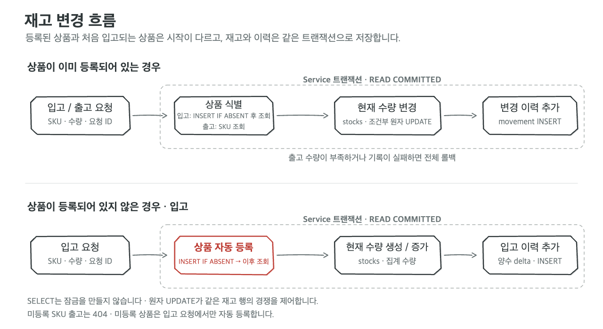

# Stock Management System

SKU 기준으로 상품을 입고·출고하고, 상품별 현재 재고와 변경 이력을 관리하는 REST API입니다.

## 설계 요약

과제의 응답 형태인 `id`, `name`, `quantity`는 유지하면서 내부 데이터는 역할에 따라 나눴습니다.

| 데이터 | 책임 |
| --- | --- |
| `items` | 고객사별 SKU와 상품 정보 |
| `stocks` | 상품별 현재 수량. 조회와 원자적인 출고 검증에 사용 |
| `stock_movements` | 확정된 입고·출고 수량 변화 기록 |



흐름 그림은 Gaegu 손글씨 글꼴(SIL Open Font License)을 사용해 별도로 구성했습니다.

### 변동 기록에서 구분하는 세 가지

| 필드 | 의미 | 예시 |
| --- | --- | --- |
| `event_type` | 어떤 재고 변화인가 | `INBOUND`, `OUTBOUND`, `ADJUSTMENT` |
| `source_type` | 변경을 발생시킨 경로·주체는 무엇인가 | `API`, `EXTERNAL`, `SYSTEM` |
| `reason` | 조정이나 시스템 변경을 왜 했는가 | 실사 차이, 외부 시스템 정정 |

예를 들어 `event_type=ADJUSTMENT`, `source_type=SYSTEM`은 시스템이 재고를 조정했다는 뜻이고, `reason`은 그 조정 사유입니다. 변경 종류와 발생 경로를 별도로 저장하면 같은 입고라도 API 요청인지 외부 연동인지 구분할 수 있습니다. 현재 구현된 입고·출고 API는 `source_type=API`로 기록합니다. 외부 연동과 시스템 변경 경로는 후속 확장용 DB 값이며, 해당 처리 API는 아직 구현하지 않았습니다.

### 핵심 설계: 현재 수량과 변동 이력 분리

`stocks`는 현재 수량을 읽고 출고 가능 여부를 원자적으로 판단하는 집계 데이터입니다. `stock_movements`는 확정된 입고·출고 증감을 append-only로 남기는 변경 기록입니다. 원장 합계를 매번 읽지 않아도 현재 수량을 빠르게 조회하면서, 수량 변경의 근거는 잃지 않도록 역할을 분리했습니다.

두 데이터를 같은 PostgreSQL 트랜잭션에서 갱신합니다. `stocks`의 조건부 UPDATE가 성공한 뒤 변동 이력을 INSERT하며, 어느 한쪽이 실패하면 둘 다 롤백됩니다. 재고 판단을 애플리케이션 인스턴스의 메모리나 로컬 캐시에 두지 않으므로 여러 인스턴스가 동시에 요청을 받아도 PostgreSQL의 원자 UPDATE와 트랜잭션이 동일한 기준이 됩니다.

### 동시성 제어와 격리 수준

격리 수준은 별도 지정 없이 PostgreSQL 기본값인 `READ COMMITTED`를 사용합니다. 이 수준에서는 각 SQL 문장이 시작될 때의 커밋된 데이터를 읽으며, 같은 트랜잭션의 연속 `SELECT`가 항상 같은 스냅샷을 보는 것은 아닙니다. 일반 `SELECT`는 행을 잠그지 않습니다. 상품을 먼저 조회하는 것만으로 동시 최초 등록이나 출고 경쟁이 해결된다고 보지 않습니다.

입고는 존재 여부를 먼저 조회하지 않고 `INSERT ... ON CONFLICT DO NOTHING`으로 상품 등록을 시도한 뒤 SKU를 조회합니다. 같은 SKU 요청이 동시에 들어오면 `(tenant_id, sku)` 유일 제약이 등록 경쟁을 조정하고, 뒤이은 조회 문장은 먼저 커밋된 상품을 확인합니다. 그림의 `상품 자동 등록`도 선행 조회가 아니라 이 INSERT 시도를 뜻합니다. 출고는 `quantity >= 요청 수량` 조건부 UPDATE 한 문장으로 수량을 검사하고 차감합니다. 동일 재고 행을 다른 트랜잭션이 먼저 갱신 중이면 PostgreSQL이 행 갱신을 기다린 뒤 최신 행에 WHERE 조건을 다시 적용하므로, 부족해진 재고는 갱신되지 않습니다. `CHECK (quantity >= 0)`도 별도 무결성 보호로 둡니다.

따라서 `@Transactional`은 조회에 잠금을 거는 설정이 아닙니다. 입고의 상품 등록·재고 반영·movement INSERT와 출고의 재고 차감·movement INSERT를 모두 커밋하거나 모두 롤백하기 위한 경계입니다. 상품 SELECT는 이 업무 처리 안에서 실행될 뿐, 잠금이나 트랜잭션 전역의 고정 스냅샷을 제공하지 않습니다. 애플리케이션에서 `SELECT FOR UPDATE` 같은 비관적 잠금은 사용하지 않습니다. PostgreSQL이 원자 UPDATE를 처리할 때 사용하는 행 잠금과는 구분합니다.

현재 수량과 `SUM(stock_movements.quantity_delta)`를 매 요청마다 비교하지 않습니다. 별도 합계 조회는 `READ COMMITTED`에서 UPDATE와 원자적으로 묶이지 않아 동시성 방어가 되지 않고, 매 요청의 원장 집계 비용도 추가합니다. 재고 변경 경로는 같은 트랜잭션으로 유지하고, 통합 테스트에서 현재 수량과 원장 합계가 일치하는지 검증합니다.

이 기본 구조는 확장 시에도 유지할 수 있습니다. 먼저 PostgreSQL 인덱스와 쿼리를 최적화하고, 더 높은 처리량이 필요해 외부 원자 갱신 수단을 검토한다면 PostgreSQL과의 데이터 정합성을 별도로 설계해야 합니다. Redis, 로컬 캐시, 분산 잠금은 현재 구현에 포함하지 않았습니다.

같은 SKU의 최초 입고가 겹쳐도 유일 제약으로 상품 행은 하나만 생기고, 각 입고는 재고 증가와 변동 기록을 반영합니다. 이 상품 등록 중복 방지와 요청 재시도 처리는 별개입니다. `requestId` 중복은 409로 거절하고 기존 성공 응답을 재사용하지 않습니다.

현재 재고 조회는 `Item`과 `Stock`을 연결하는 JPQL DTO projection으로 `id`, `name`, `quantity`를 한 번에 읽습니다. fetch join은 엔티티 연관관계가 있을 때 사용하는 방식입니다. 현재 두 엔티티에는 연관관계가 없고 조회 전용 관계를 추가할 이유가 없어, 필요한 값만 DTO로 바로 조회합니다. 이 경로는 SQL 한 번으로 끝나며 지연 로딩으로 인한 N+1도 발생하지 않습니다.

미등록 SKU 입고는 상품명 없이도 진행합니다. 이때 이름은 `null`로 저장하고 자동 등록 상품은 보정 대상 상태로 표시합니다. 인증 없는 MVP에서는 설정된 Tenant ID를 사용하며 요청 헤더를 보안 경계로 취급하지 않습니다.

## 기술 스택

| 구분 | 기술 |
| --- | --- |
| 애플리케이션 | Java 21, Spring Boot 4.1.3 |
| 빌드 | Gradle Kotlin DSL |
| 데이터베이스 | PostgreSQL 17, Spring Data JPA, Flyway |
| API 문서 | springdoc-openapi 3.2.0 |
| 테스트 | JUnit Jupiter 5.14.4, Testcontainers 2.0.5 |
| 커넥션 풀 | Spring Boot 기본 HikariCP, 최대 연결 10 |

## 로컬 실행

필요 항목: Java 21, Docker, Docker Compose

```bash
./run-local.sh
```

스크립트가 PostgreSQL을 시작하고 Flyway로 스키마를 적용한 뒤 애플리케이션을 실행합니다. 기본 HTTP 포트는 실행 시 선택되며 시작 로그에서 확인할 수 있습니다. 직접 지정하려면 `SERVER_PORT=18765 ./run-local.sh`를 사용합니다.

| 항목 | 주소 |
| --- | --- |
| Swagger UI | `http://localhost:<port>/swagger-ui.html` |
| OpenAPI JSON | `http://localhost:<port>/v3/api-docs/stock-v1` |

DB 접속은 `DB_URL`, `DB_USERNAME`, `DB_PASSWORD`로 변경할 수 있습니다. 개발용 Tenant ID는 `TENANT_ID` 환경 변수로 설정하며 기본값은 `1`입니다. PostgreSQL은 `docker compose stop postgres`로 중지합니다.

## API

기본 경로는 `/api/v1`입니다. SKU는 고객사별 상품 식별자이고, 응답의 `id`는 내부 상품 ID입니다. SKU 앞뒤 공백은 제거하며 대소문자는 구분합니다.

| Method | 경로 | 요청 | 성공 응답 | 주요 오류 |
| --- | --- | --- | --- | --- |
| `POST` | `/stocks/inbound` | `sku`, `quantity`, `requestId`; 선택 `name`, `reason` | `200` 상품 ID·이름·현재 수량 | `400` 잘못된 요청, `409` 중복 요청 ID |
| `POST` | `/stocks/outbound` | `sku`, `quantity`, `requestId`; 선택 `reason` | `200` 상품 ID·이름·현재 수량 | `400` 잘못된 요청, `404` 미등록 SKU, `409` 재고 부족·중복 요청 ID |
| `GET` | `/stocks/{itemId}` | 경로의 상품 ID | `200` 상품 ID·이름·현재 수량 | `404` 미등록 상품 |

입고 예시:

```json
{
  "sku": "SKU-001",
  "name": "상품 A",
  "quantity": 10,
  "requestId": "11111111-1111-1111-1111-111111111111"
}
```

입고와 출고 응답은 다음 형태입니다.

```json
{
  "id": 1,
  "name": "상품 A",
  "quantity": 10
}
```

`quantity`는 1 이상의 정수입니다. 잘못된 JSON, 필수값 누락, UUID 형식 오류는 `400`이며 오류 응답은 `code`, `message`를 포함합니다.

## 테스트

```bash
./gradlew test
./gradlew build
```

| 테스트 클래스 | 확인 범위 |
| --- | --- |
| `StockApiTest` | HTTP 요청 검증, 입고·출고·조회, 오류 및 트랜잭션 롤백 |
| `StockConcurrencyIntegrationTest` | 동시 최초/기존 입고, 동시 출고, 입고·출고 혼합 요청, 재고와 원장 합계 |

두 테스트 모두 Testcontainers PostgreSQL을 사용하며 H2로 대체하지 않습니다.

## 범위와 확장

| 이번 과제에서 집중한 부분 | 필요성은 고려했지만 MVP에서 구현하지 않은 부분 |
| --- | --- |
| 미등록 SKU 최초 입고와 동시 최초 등록 | 인증 및 사용자별 Tenant 권한 부여 |
| 원자적 조건부 UPDATE로 출고 시 음수 재고 방지 | 상품 정보 보정 API와 사람의 검토 화면 |
| 현재 수량 집계와 append-only 변경 이력의 트랜잭션 정합성 | 바코드 인식 뒤 별도 확정·승인 업무 흐름 |
| 실제 PostgreSQL 기반 API·동시성·롤백 통합 테스트 | 예약 재고, 물류센터, 미입고·미출고 업무 관리 |
| 상품과 재고 조회 응답을 불필요한 추가 SQL 없이 반환 | PostgreSQL과 외부 캐시 간 동기화 및 분산 환경 최적화 |

외부 캐시나 별도 원자 갱신 수단은 성능 요구와 측정 결과가 생긴 뒤 판단합니다. 현재는 PostgreSQL을 단일 정합성 기준으로 유지합니다.

## AI 개발 도구

| 도구 | 사용 |
| --- | --- |
| Serena MCP | 프로젝트 코드 탐색과 변경 위치 확인 |
| Context7 MCP | 사용 라이브러리의 공식 문서와 호환 정보 확인 |
