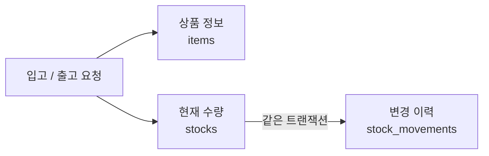

# Stock Management System

SKU 기준으로 상품을 입고·출고하고, 상품별 현재 재고와 변경 이력을 관리하는 REST API입니다.

## 설계 요약

과제의 응답 형태인 `id`, `name`, `quantity`는 유지하면서 내부 데이터는 역할에 따라 나눴습니다.

| 데이터 | 책임 |
| --- | --- |
| `items` | 고객사별 SKU와 상품 정보 |
| `stocks` | 상품별 현재 수량. 조회와 원자적인 출고 검증에 사용 |
| `stock_movements` | 확정된 입고·출고 수량 변화 기록 |



원본 다이어그램: [stock-flow.mmd](docs/diagrams/stock-flow.mmd)

- 현재 수량과 변동 이력을 나눈 이유: 매번 원장 합계를 계산하지 않고 현재고를 읽고, 변경 근거는 별도 기록으로 보존합니다.
- 커넥션 풀: Spring Boot가 기본 HikariCP를 구성합니다. 기본 최대 연결 수 10을 사용하며, MVP에서 별도 풀 설정은 두지 않습니다.
- 두 데이터를 같은 트랜잭션에서 갱신하는 이유: 재고 변경이 성공했는데 이력이 빠지거나, 이력만 남는 상태를 방지합니다.
- 출고는 `현재 수량 >= 요청 수량` 조건을 포함한 UPDATE로 처리합니다. DB가 원자적으로 조건을 확인하고 수량을 바꿔 음수 재고를 막습니다.
- 같은 SKU의 최초 입고가 겹쳐도 유일 제약으로 상품 행은 하나만 생깁니다. 각 요청은 자신의 재고 증가와 변동 기록을 계속 처리합니다.
- 재시도 식별자인 `requestId` 중복은 별도 충돌로 거절합니다. 성공 응답을 재사용하지 않습니다.
- 재고 조회는 `Item`과 `Stock`을 연결하는 JPQL DTO projection으로 `id`, `name`, `quantity`만 한 번에 조회합니다. fetch join은 엔티티 연관관계가 있어야 사용할 수 있어, 조회만을 위해 양방향 연관관계를 추가하는 대신 필요한 컬럼만 DTO로 바로 받습니다. 현재 재고 조회 경로에는 지연 로딩 연관관계가 없어 N+1도 발생하지 않습니다.
- 미등록 SKU 입고는 이름 없이도 처리할 수 있습니다. 상품명은 nullable이며, 자동 등록 상품은 보정 대상 상태로 표시합니다.

상세 설계는 [아키텍처 문서](docs/ARCHITECTURE.md), 주요 결정은 [결정 기록](docs/DECISIONS.md)에 있습니다.

## 기술 스택

| 구분 | 기술 |
| --- | --- |
| 애플리케이션 | Java 21, Spring Boot 4.1.3 |
| 빌드 | Gradle Kotlin DSL |
| 데이터베이스 | PostgreSQL 17, Spring Data JPA, Flyway |
| API 문서 | springdoc-openapi 3.2.0 |
| 테스트 | JUnit Jupiter 5.14.4, Testcontainers 2.0.5 |

## 로컬 실행

필요 항목: Java 21, Docker, Docker Compose

```bash
./run-local.sh
```

스크립트가 PostgreSQL을 시작하고 Flyway로 스키마를 적용한 뒤 애플리케이션을 실행합니다. 기본 HTTP 포트는 실행 시 선택되며 시작 로그에서 확인할 수 있습니다. 직접 지정하려면 `SERVER_PORT=18765 ./run-local.sh`를 사용합니다.

| 항목 | 주소 |
| --- | --- |
| Swagger UI | `http://localhost:<port>/swagger-ui.html` |
| OpenAPI JSON | `http://localhost:<port>/v3/api-docs/stock-v1` |

DB 접속은 `DB_URL`, `DB_USERNAME`, `DB_PASSWORD`로 변경할 수 있습니다. 개발용 Tenant ID는 `TENANT_ID` 환경 변수로 설정하며 기본값은 `1`입니다. PostgreSQL은 `docker compose stop postgres`로 중지합니다.

## API

기본 경로는 `/api/v1`입니다. SKU는 고객사별 상품 식별자이고, 응답의 `id`는 내부 상품 ID입니다. SKU 앞뒤 공백은 제거하며 대소문자는 구분합니다.

| Method | 경로 | 요청 | 성공 응답 | 주요 오류 |
| --- | --- | --- | --- | --- |
| `POST` | `/stocks/inbound` | `sku`, `quantity`, `requestId`; 선택 `name`, `reason` | `200` 상품 ID·이름·현재 수량 | `400` 잘못된 요청, `409` 중복 요청 ID |
| `POST` | `/stocks/outbound` | `sku`, `quantity`, `requestId`; 선택 `reason` | `200` 상품 ID·이름·현재 수량 | `400` 잘못된 요청, `404` 미등록 SKU, `409` 재고 부족·중복 요청 ID |
| `GET` | `/stocks/{itemId}` | 경로의 상품 ID | `200` 상품 ID·이름·현재 수량 | `404` 미등록 상품 |

입고 예시:

```json
{
  "sku": "SKU-001",
  "name": "상품 A",
  "quantity": 10,
  "requestId": "11111111-1111-1111-1111-111111111111"
}
```

입고와 출고 응답은 다음 형태입니다.

```json
{
  "id": 1,
  "name": "상품 A",
  "quantity": 10
}
```

`quantity`는 1 이상의 정수입니다. 잘못된 JSON, 필수값 누락, UUID 형식 오류는 `400`이며 오류 응답은 `code`, `message`를 포함합니다.

## 테스트

```bash
./gradlew test
./gradlew build
```

| 테스트 클래스 | 확인 범위 |
| --- | --- |
| `StockApiTest` | HTTP 요청 검증, 입고·출고·조회, 오류 및 트랜잭션 롤백 |
| `StockConcurrencyIntegrationTest` | 동시 최초/기존 입고, 동시 출고, 입고·출고 혼합 요청, 재고와 원장 합계 |

두 테스트 모두 Testcontainers PostgreSQL을 사용하며 H2로 대체하지 않습니다.

## 범위와 확장

- MVP에는 입고·출고·현재고 조회를 포함합니다. 인증, 상품 정보 보정 API, 예약 재고와 물류센터 업무 모델은 포함하지 않습니다.
- Tenant ID는 데이터 구분을 위한 설정값입니다. 인증 없는 상태에서 임의 요청 헤더를 Tenant 보안 경계로 사용하지 않습니다.
- 바코드 인식은 상품 식별이며, 인식만으로 재고를 변경하지 않습니다.
- 필요해지면 실제 인증을 통한 Tenant 식별과 상품 정보 보정 흐름을 추가할 수 있습니다.

## AI 개발 도구

| 도구 | 사용 |
| --- | --- |
| Serena MCP | 프로젝트 코드 탐색과 변경 위치 확인 |
| Context7 MCP | 사용 라이브러리의 공식 문서와 호환 정보 확인 |

프로젝트 규칙과 작업 흐름은 [CONVENTIONS](docs/CONVENTIONS.md), [WORKFLOW](docs/WORKFLOW.md), [TASKS](docs/TASKS.md)를 참고하세요.
